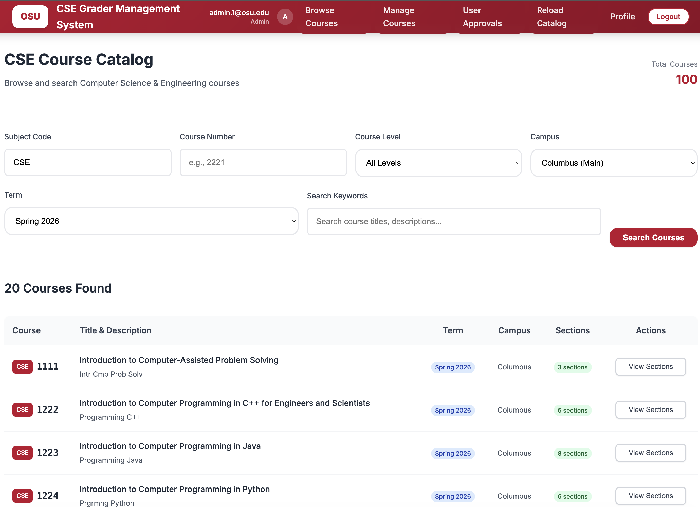
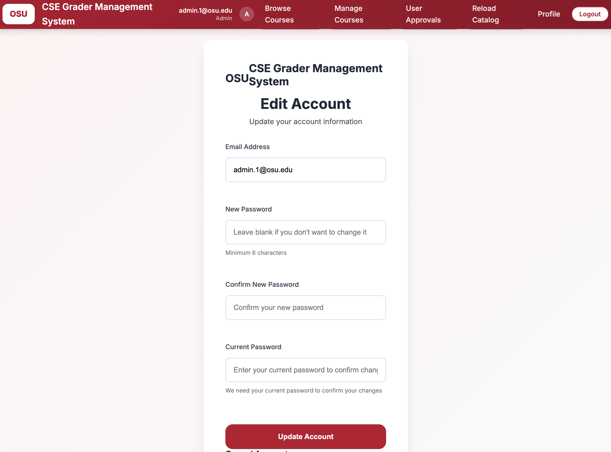
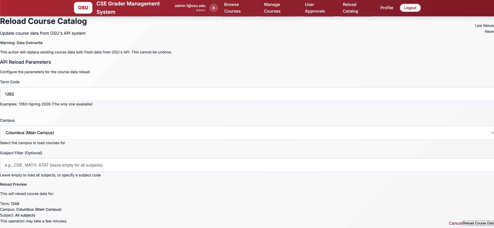
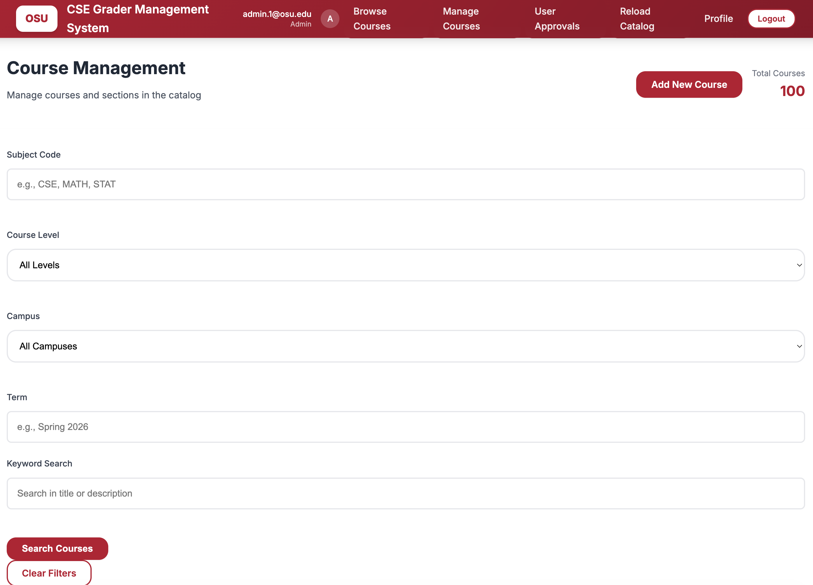

# CSE Grader Management System

Modern Rails 7.2 project used by the OSU CSE department to recruit, vet, and assign course graders. Students browse the official OSU catalog, instructors review sections, and admins approve accounts, reload data from the OSU API, and curate courses.

---

## Table of Contents

1. [Repository Layout](#1-repository-layout)
2. [Application at a Glance](#2-application-at-a-glance)
3. [Stack & Dependencies](#3-stack--dependencies)
4. [Getting Started](#4-getting-started)
5. [Data & Catalog Sync](#5-data--catalog-sync)
6. [Roles & Access Control](#6-roles--access-control)
7. [Frontend & UX](#7-frontend--ux)
8. [Testing & Quality Gates](#8-testing--quality-gates)
9. [Deployment & Operations](#9-deployment--operations)
10. [Troubleshooting](#10-troubleshooting)
11. [Need Help?](#11-need-help)

---

## 1. Repository Layout

```text
.
├── README.md          # This document
└── cse_grader/        # Rails application (API, UI, assets, jobs, tests)
```

Key directories inside `cse_grader/`:

| Location | Highlights |
| --- | --- |
| `app/controllers` | `ApplicationController#require_role!`, catalog browsing, admin dashboards, Devise passwords override. |
| `app/models` | `User` role/approval logic, OSU email validation, `Course`/`Section` associations and scopes. |
| `app/services/osu_classes_fetcher.rb` | HTTParty client for `https://content.osu.edu/v2/classes/search` with upsert logic. |
| `app/javascript` | Stimulus controllers (`filter`, `modal`, `notification`), `utils/performance.js`, `view_sections.js`. |
| `app/assets/stylesheets/application.css` | OSU-branded CSS tokens, component styles, layout primitives. |
| `app/views/pwa` | Manifest + service worker stubs exposed via `/manifest` and `/service-worker`. |
| `config/routes.rb` | Public landing page, catalog, profile, password helper, `/admin` namespace. |
| `db/seeds.rb` / `config/initializers/default_admin.rb` | Default admin (`admin.1@osu.edu` / `AdminPassword123!`) + sample course/section. |
| `Procfile.dev`, `bin/dev` | Foreman script that runs the Rails server and Tailwind watcher together. |
| `.github/workflows/ci.yml` | Brakeman, importmap audit, RuboCop, and full Rails test suite. |
| `Dockerfile` | Multi-stage production build with Bootsnap precompile & non-root runtime user. |

---

## 2. Application at a Glance

- **Landing preview:**  
  
- **Landing + Devise UX:** Marketing-style home page, branded auth forms, and a development-only password reset view (`/password-reset-dev`).
- **Catalog Explorer (`CatalogController#index`):** Paginated by Pagy with subject/number/level/campus/keyword filters, expandable sections via `view_sections.js`.
- **Catalog UI preview:**  
  
- **Admin Suite (`/admin`):**
  - Dashboard metrics (pending approvals, total courses).
  - Full course CRUD with section listings.
  - Catalog reload workflow powered by `OsuClassesFetcher`.
  - Approval console for instructor/admin onboarding.
- **Admin UI previews:**  
  _Reload workflow_  
    
  _Course management table_  
  
- **Profiles:** `ProfilesController#show` surfaces user metadata, role/status badges, and wraps Devise’s `update_with_password`.

---

## 3. Stack & Dependencies

- **Runtime:** Ruby 3.3.8 (`.ruby-version`), Rails 7.2.2.2, Puma, Turbo, Stimulus via importmap (no Node build step).
- **Data:** SQLite (dev/test), HTTParty client for OSU API, Pagy for pagination, TailwindCSS Rails gem for utilities.
- **Auth & Security:** Devise, role enum on `User`, OSU email regex, approval workflow, filtered parameter logging, `force_ssl` in production.
- **Tooling:** Foreman-based `bin/dev`, Bootsnap, GitHub Actions CI (Brakeman/importmap audit/RuboCop/tests), optional Redis for production ActionCable.

---

## 4. Getting Started

### 4.1 Prerequisites

- Ruby 3.3.8 with Bundler 2.x
- SQLite3 CLI

### 4.2 Install & Bootstrap

```bash
cd cse_grader
bin/setup          # installs gems, prepares DB, clears logs, restarts app
bin/rails db:seed  # optional confirmation of seeded admin/course data
```

`bin/setup` runs `bin/rails db:prepare`, creating `storage/development.sqlite3`.

### 4.3 Run the App

```bash
bin/dev            # rails server + tailwind watcher (default http://localhost:3000)
# or
bin/rails server
```

Login with the seeded admin (`admin.1@osu.edu` / `AdminPassword123!`) and change credentials via the profile screen. In development, Devise writes emails to `tmp/mails`; password reset requests redirect to `/password-reset-dev` with a copyable link.

---

## 5. Data & Catalog Sync

- **Admin UI:** Navigate to **Admin → Reload Catalog** (`/admin/catalog/reload`). The Stimulus `filter_controller` previews term/campus/subject and submits to `perform_reload_admin_catalog_path`.
- **Console ingestion:**

```ruby
# rails console
OsuClassesFetcher.fetch_and_save!(term: "1262", campus: "col", subject: "cse")
```

`OsuClassesFetcher` paginates through OSU API responses, normalizes courses/sections, and upserts records inside a transaction. The `fetch_courses` method returns in-memory objects without touching the DB—handy for previews or diagnostics.

- **Seed data:** Ensures an admin account plus a CSE 2221 course/section so catalog pages render before the first sync.

---

## 6. Roles & Access Control

| Role | Approval Default | Landing After Sign-In | Capabilities |
| --- | --- | --- | --- |
| Student | Auto-approved (`User#set_default_approval`) | Catalog | Browse/search catalog, view profile, change password. |
| Instructor | Pending until admin approval | Catalog (after approval) | Same as student; basis for instructor tooling. |
| Admin | Pending until approved | `/admin` dashboard | Full admin suite: course CRUD, catalog reload, approvals. |

Implementation notes:

- `ApplicationController` centralizes `require_role!`, `current_*?` helpers, and post-auth redirects.
- `config/routes.rb` wires `root "home#index"`, catalog resources, `resource :profile`, Devise routes + `/password-reset-dev`, and the `/admin` namespace (dashboard, courses, catalog reload/approve/deny).

---

## 7. Frontend & UX

- **Styling:** `app/assets/stylesheets/application.css` defines OSU color tokens, cards, tables, nav, badges, hero layout, auth forms, and profile widgets. Tailwind is available for utility classes via `bin/rails tailwindcss:watch`.
- **Stimulus controllers:**
  - `filter_controller.js` (reload preview, loading state, toast feedback).
  - `modal_controller.js` (accessible modals) & `notification_controller.js` (auto-dismiss alerts).
  - `view_sections.js` (toggle course sections inline).
  - `utils/performance.js` (Web Vitals logging, lazy loading helpers).
- **PWA hooks:** `/manifest` and `/service-worker` stubs live in `app/views/pwa`, ready for offline enhancements.

---

## 8. Testing & Quality Gates

- **Rails test suite:** `bin/rails test` (unit/integration) and `bin/rails test:system` (Chrome required; CI installs it). Run `bin/rails db:test:prepare` before first execution.
- **Static analysis & audits:**
  - `bin/rubocop` (Rails Omakase rules).
  - `bin/brakeman` (security scan).
  - `bin/importmap audit` (JS dependency audit).
- **CI:** `.github/workflows/ci.yml` executes Brakeman → importmap audit → RuboCop → tests, uploading failed system-test screenshots as artifacts.

---

## 9. Deployment & Operations

- **Environment variables:**
  - `RAILS_MASTER_KEY` (or `config/master.key`) to decrypt credentials.
  - `DEFAULT_ADMIN_EMAIL` / `DEFAULT_ADMIN_PASSWORD` to override bootstrap admin.
  - `REDIS_URL` for ActionCable in production (`redis://localhost:6379/1` default).
  - `PORT`, `RAILS_LOG_LEVEL`, etc., for Puma and logging.
- **Docker workflow:**

```bash
cd cse_grader
docker build -t cse-grader .
docker run --rm -it -p 3000:3000 \
  -e RAILS_MASTER_KEY=... \
  -e DEFAULT_ADMIN_EMAIL=admin.1@osu.edu \
  cse-grader
```

The multi-stage Dockerfile precompiles Bootsnap caches and assets (`SECRET_KEY_BASE_DUMMY=1 ./bin/rails assets:precompile`) and runs as a non-root `rails` user.

- **Production considerations:** `config/environments/production.rb` enables SSL, logs to STDOUT, and assumes persistent storage for SQLite. Migrate to Postgres/MySQL for multi-instance deployments.

---

## 10. Troubleshooting

- **Password reset in dev:** Trigger “Forgot password?” on the login page; the app redirects to `/password-reset-dev` with a copyable URL.
- **Email delivery:** Development mails are written to `tmp/mails`; no SMTP setup needed.
- **Clearing state:** `bin/setup` clears logs/tmp files. Manual artifacts live under `log/` and `tmp/`.
- **ActionCable:** Uses `:async` adapter in development/test; set `REDIS_URL` or adjust `config/cable.yml` for production.
- **Storage:** Uploaded files (if implemented) and SQLite DBs live under `storage/`; persist this directory when containerizing or deploying.

---

## 11. Need Help?

Open an issue describing the task (course sync, grader matching, UI polish, etc.) and reference the relevant files/sections above so teammates can jump in quickly.
